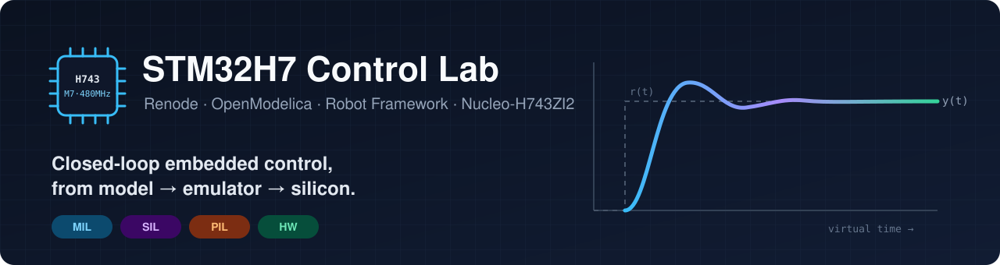
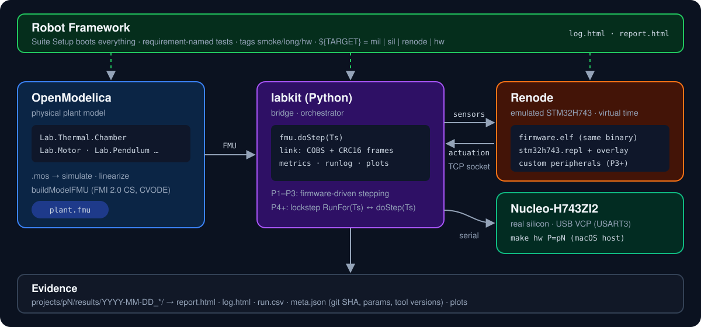
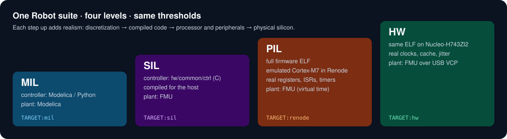

<p align="center">
  
</p>

<p align="center">
  
  
  
  
  
  
</p>

<p align="center">
  <b>A 7-project curriculum for building and verifying closed-loop control firmware on an STM32H7.</b><br>
  Physical plants are modeled in <b>OpenModelica</b>, firmware runs unmodified in the <b>Renode</b> emulator and on a real <b>Nucleo-H743ZI2</b>,<br>
  and <b>Robot Framework</b> checks every result against written requirements.
</p>

<p align="center">
  <a href="#-the-idea">Idea</a> ·
  <a href="#-how-it-fits-together">Architecture</a> ·
  <a href="#-roadmap">Roadmap</a> ·
  <a href="#-whats-in-each-project">Projects</a> ·
  <a href="#-getting-started">Getting started</a> ·
  <a href="#-repository-layout">Layout</a> ·
  <a href="#-documentation">Docs</a>
</p>

---

## 💡 The idea

Most embedded control projects stop at "it works on my board". This repo goes further. The **same controller** is checked at four levels of realism, and each project leaves evidence that can be reproduced:

- 🧪 **Model the physics properly.** Thermal chambers, nonlinear tanks, DC motors, an inverted pendulum, and a battery pack are written in Modelica, then exported as FMUs.
- 🖥️ **Run the real firmware without hardware.** The firmware runs in Renode on an emulated STM32H743, with the plant in the loop and timing in deterministic virtual time.
- 🔌 **Then run it on silicon.** The same ELF runs on a Nucleo-H743ZI2, with the plant model connected over USB.
- ✅ **Verify like a product team.** Tests are named after requirements, tagged smoke, long, and hardware, traced to requirement IDs, and run in CI.
- 📈 **Use control theory, not trial and error.** Gains come from scripts that use the model's linearization: PID, gain scheduling, cascaded loops, LQR, Kalman filter, and EKF.

> **Status:** planning is complete and P0 (toolchain warm-up) is up next. Results, plots, and reports will appear here as each project is finished and tagged `pN-done`.

---

## 🧩 How it fits together

<p align="center">
  
</p>

| Piece | Role |
|---|---|
| **OpenModelica** | Plant models (`models/Lab/…`) scripted with `.mos`, linearized for controller design, and exported as FMI 2.0 co-simulation FMUs (CVODE inside). |
| **labkit** (Python) | Steps the FMU, speaks a COBS + CRC16 binary protocol to the firmware over TCP (Renode) or serial (board), and logs runs with metadata. |
| **Renode** | Emulates the STM32H743 so the **unmodified firmware ELF** runs with real registers, ISRs, and timers. Custom peripherals are added where needed (encoder, ADC). |
| **Firmware** | STM32CubeMX-generated HAL project. Control algorithms sit in a HAL-free C layer, so the same code also builds on the host for SIL. |
| **Robot Framework** | Boots the stack, runs requirement-style tests in virtual time, and produces `log.html` / `report.html`. |

The time model evolves on purpose. In **P1–P3** the firmware drives stepping, one FMU step per control tick. From **P4** an orchestrator runs Renode and the FMU in lockstep. The reasons are written up in [ADR-0005](docs/adr/0005-time-model.md).

### One suite, four levels

<p align="center">
  
</p>

---

## 🗺️ Roadmap

| | Project | Plant | Control concept | Key tool features | Status |
|---|---|---|---|---|---|
| **P0** | Toolchain warm-up | RC circuit | (none) | `.resc`/`.repl`, OMEdit vs. equations, first Robot test | ⏳ next |
| **P1** | Thermal chamber | Heater + thermal mass + NTC | Discrete PID, anti-windup, D-filter | `.mos` scripting, FMU export, socket bridge, Suite Setup | ⬜ |
| **P2** | Coupled water tanks | Torricelli outflow, pump, valve | Gain scheduling + feedforward | `linearize()`, OMPython sweeps, Renode snapshots, test templates | ⬜ |
| **P3** | DC motor servo | Electrical + rotational + friction | Cascaded current/speed/position loops | Custom C# peripherals, GDB, CPU hooks, transformational debugger | ⬜ |
| **P4** | Inverted pendulum | MultiBody cart-pole | LQR + Kalman filter | Lockstep virtual-time co-sim, profiler, robustness sweeps | ⬜ |
| **P5** | Battery management | 4-cell pack with fault modes | Protection FSM, balancing, SOC (EKF) | Fault injection, multi-machine, requirement traceability | ⬜ |
| **P6** | Capstone | (any of the above) | Quantization, delay, fixed-point | Clocked Modelica, MIL→SIL→PIL→HW, CI with coverage | ⬜ |

Full detail, including milestones, done-when criteria, and risks: **[docs/ROADMAP.md](docs/ROADMAP.md)**.

---

## 🔬 What's in each project

<details>
<summary><b>P0: Toolchain warm-up</b>: every tool producing output on its own</summary>

- CubeMX project from the NUCLEO-H743ZI2 board preset, generated as CMake: blinky plus `Hello` on the ST-LINK VCP (USART3).
- Boot the ELF in Renode from a hand-written `.resc`. Read and annotate the H743 `.repl` platform to learn how Renode describes memory, peripherals, and interrupts.
- The same RC circuit built twice in OpenModelica, graphically and as text equations, then compared.
- A first Robot test that boots the firmware and waits for `Hello` on the UART.
</details>

<details>
<summary><b>P1: Thermal chamber with PID</b>: the first closed loop</summary>

- Heater, thermal mass, and ambient-loss model with a nonlinear NTC sensor, fully scripted in `.mos` and exported as an FMU.
- Firmware PID with derivative-on-measurement filtering and back-calculation anti-windup, unit-tested on the host.
- A Python bridge exchanges temperature and duty cycle with the firmware over a Renode socket terminal, and with the real board over USB serial.
- A comparison of the continuous Modelica PID, the Renode firmware PID, and the hardware PID: what discretization changes.
</details>

<details>
<summary><b>P2: Coupled water tanks</b>: nonlinear plant, model analysis</summary>

- A square-root (Torricelli) nonlinearity, linearized at several operating points with `linearize()`, then compared linear vs. nonlinear.
- Gain-scheduled PI plus feedforward, generated from the linearizations into a C header.
- Renode snapshots: boot once, then fork every test from the saved state.
- Data-driven Robot tests (`Test Template`) with `smoke` and `long` tags.
</details>

<details>
<summary><b>P3: DC motor servo</b>: real peripheral modeling</summary>

- A multi-domain model: armature R, L, and back-EMF coupled to inertia, gearbox, and friction with stiction events.
- Custom Renode peripherals (a quadrature encoder and an ADC current sense) fed from the FMU. PWM duty is read straight from timer compare registers.
- GDB attached to the emulator, CPU hooks timing the control ISR, and platform extensions in an overlay `.repl`.
- Cascaded current, speed, and position loops tuned from model parameters, with a custom metrics keyword library (overshoot, rise time, settling time).
</details>

<details>
<summary><b>P4: Inverted pendulum</b>: an unstable plant that exposes any timing error</summary>

- A MultiBody cart-pole with 3D animation, linearized at upright to get the matrices for LQR design.
- True lockstep co-simulation: Renode `RunFor(1 ms)` ↔ FMU `doStep(1 ms)`, with virtual and host time logged side by side.
- LQR plus a Kalman filter on simulated encoder and IMU data. A robustness sweep over mass, noise, and sample rate produces a stability map.
</details>

<details>
<summary><b>P5: Battery management system</b>: verification engineering</summary>

- A 4-cell equivalent-circuit pack with injectable faults: a drifting cell, an open sense wire, a thermal rise.
- Fault injection from the Renode monitor, watchdog resets, and a second emulated "charger" machine on a UART hub.
- A requirement-traced test matrix (`REQ-OV-01: overvoltage cut-off ≤ 100 ms`) with a generated traceability report.
- A protection state machine, passive balancing, and SOC estimation with Coulomb counting and an EKF.
</details>

<details>
<summary><b>P6: Capstone</b>: MIL → SIL → PIL → HW with CI</summary>

- The controller written in Modelica with clocked blocks, and exported as a source-code FMU.
- One Robot suite runs against every level by switching `${TARGET}`, with headless Renode and coverage in GitHub Actions.
- Quantization, sampling delay, and float vs. fixed point, each measured at every level.
</details>

---

## 🧰 Tech stack

| Area | Tools |
|---|---|
| Hardware | STM32 Nucleo-H743ZI2 (STM32H743ZI, Cortex-M7 @ 480 MHz, FPU, D-cache) |
| Firmware | STM32CubeMX 6.x, STM32Cube HAL/LL, CMake + Ninja, Arm GNU Toolchain |
| Emulation | Renode (STM32H743 platform + project overlays, custom C# peripherals) |
| Modeling | OpenModelica (OMC, OMEdit, OMPython), Modelica Standard Library 4.x, FMI 2.0 |
| Co-simulation | Python 3.11, FMPy, the `labkit` bridge and orchestrator |
| Testing | Robot Framework + Renode keywords, pytest, host unit tests for C |
| Control design | python-control, NumPy, SciPy |
| Environment | `linux/amd64` devcontainer (same image locally and in CI), GitHub Actions |

---

## 🚀 Getting started

> The build system and devcontainer are created in **P0**, so the commands below are the target workflow and don't work yet. Until then, start from [docs/dev-environment.md](docs/dev-environment.md).

**Host (macOS):** STM32CubeMX with the STM32CubeH7 pack, `stlink`, `pyserial`, and OrbStack or Colima. **Everything else** runs in the devcontainer.

```sh
# inside the devcontainer
make doctor                          # check tool versions
make fw   P=p1                       # build firmware (CubeMX CMake project)
make fmu  P=p1                       # export + validate the plant FMU
make test P=p1 TAGS=smoke            # Robot suite against Renode

# on the macOS host, board connected
make hw   P=p1                       # flash and run the same suite on silicon
```

---

## 📁 Repository layout

```
fw/
  common/ctrl/        HAL-free control algorithms (build for arm + host)
  common/bsp/         thin HAL helpers
  common/link/        COBS + CRC16 protocol (C side)
  pN_<name>/          CubeMX project per project (.ioc + generated code + app/)
models/Lab/           shared Modelica package
tools/labkit/         Python: FMU, Renode control, bridge, metrics, run logging, plots
tests/common/         shared Robot resources and keyword libraries
projects/pN_<name>/   model/ scripts/ renode/ robot/ results/ + README ("What I learned")
docs/                 roadmap, ADRs, environment, troubleshooting, glossary, notes
.claude/              Claude Code workspace: rules, specialist agents, workflow skills, guard hooks
```

---

## 📚 Documentation

| Doc | What's inside |
|---|---|
| [Roadmap](docs/ROADMAP.md) | The full curriculum: per-project features, milestones, done-when criteria, risks |
| [Architecture decisions](docs/adr/README.md) | Why CubeMX + CMake, the amd64 devcontainer, the HAL-free control layer, the link protocol, and the time model |
| [Dev environment](docs/dev-environment.md) | Host vs. container split, setup steps, pinned versions |
| [Feature checklist](docs/feature-checklist.md) | Which Renode, OpenModelica, Robot, and control features are demonstrated, with links |
| [Troubleshooting](docs/troubleshooting.md) | Known problems, their root causes, and their fixes |
| [Glossary](docs/glossary.md) | MIL/SIL/PIL, FMU, quantum, ZOH, and more |

### How this repo proves the learning
Every project folder ships its models, scripts, Renode files, firmware, and Robot suite, **plus**:
- a README with *features used*, *problems hit (symptom → root cause → fix)*, *results*, and *what I'd do differently*
- committed `report.html` / `log.html`, plots, and run metadata (git SHA, parameters, tool versions)
- a `pN-done` git tag once it passes the [definition of done](CLAUDE.md#definition-of-done-per-project)

### Built with Claude Code
This repo includes a project-specific [Claude Code workspace](.claude/README.md):
- specialist agents (firmware reviewer, Renode specialist, Modelica modeler, controls engineer, ...)
- workflow skills (`/start-project`, `/renode-triage`, `/fmu-export-validate`, `/close-project`, ...)
- hooks that protect CubeMX-generated code and committed results

Learning steps marked 🎓 are done by hand.

---

<p align="center">
  Made by <a href="https://github.com/kiranj26">Kiran Jojare</a>.
</p>
