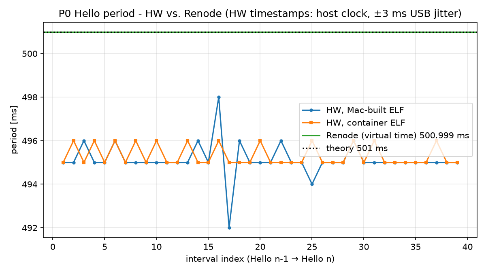

# P0: Toolchain warm-up (Blinky)

> Status: ✅ complete 2026-10-11: all "done when" items met, CI green, evidence in `results/` (PR #3 + follow-up PR merged; tag `p0-done`). Open items for later are listed in §6 and marked _open_. · Time spent: not tracked

## 1. Goal
Get every tool producing output **independently** before connecting anything. CubeMX generates a CMake project for the NUCLEO-H743ZI2 that blinks LD1 (PB0) and prints `Hello <n>` on USART3 (ST-LINK VCP, 115200 baud). The **same ELF** (built in the devcontainer) boots in Renode, where a Robot suite checks it, and runs on the real board. Separately, OpenModelica simulates an RC circuit twice, from library components and as a hand-written ODE, and compares both with the analytic answer. There's no closed loop yet; the point is to know what each tool does on its own, and where the Renode H743 platform model stops matching the silicon.

## 2. Platform
| Item | Value |
|---|---|
| SYSCLK / timer clock | 400 MHz / 200 MHz (HCLK 200, APB1–4 100; see [`fw/p0_blinky/CUBEMX.md`](../../fw/p0_blinky/CUBEMX.md)) |
| Clock source / power | HSE bypass 8 MHz (ST-LINK MCO) → PLL1 M=1 N=100 P=2 (VCO 800 MHz, wide); LDO supply, VOS1; flash 2 WS; rev V |
| CubeMX / HAL | STM32CubeMX 6.18, STM32Cube FW_H7 V1.13.0, CMake + GCC |
| Toolchain / image | devcontainer `linux/amd64`: Arm GNU 15.3.rel2 (build arm-15.180), OpenModelica 1.27.1 + MSL 4.0.0 (exact pin, verified by `make doctor`), Renode 1.17.0, Robot 6.1, Python 3.11 ([pins](../../docs/dev-environment.md)) |
| Firmware (Debug, canonical) | text 23 848 B, data 96 B, bss 2 056 B (flash 1.14 %, DTCM 1.64 %); `.bin` sha256 `50ac07ca…` |
| Control Ts | N/A in P0 (no control loop) |
| Console | USART3 (PD8/PD9) → ST-LINK VCP / Renode `sysbus.usart3` |
| Plant link | N/A in P0 (starts in P1) |
| Renode | 1.17.0, `@platforms/cpus/stm32h743.repl` + [`renode/p0_overlay.repl`](renode/p0_overlay.repl) (DBGMCU identity = rev V) |
| Plant FMU | N/A in P0 (the RC model is simulated with `simulate()` only) |
| RC model | R = 1 kΩ, C = 1 µF, τ = 1 ms, 3.3 V step, StopTime 5 ms (5τ), DASSL, rtol 1e-6, 500 intervals |

## 3. Features used
🎓 = a first use the roadmap reserves for me. Who actually did each one is in §8.

| Tool | Feature | Where |
|---|---|---|
| STM32 | 🎓 CubeMX board selector (NUCLEO-H743ZI2), clock tree (HSE bypass → PLL1 → 400 MHz), CMake generation | [p0_blinky.ioc](../../fw/p0_blinky/p0_blinky.ioc), [CUBEMX.md](../../fw/p0_blinky/CUBEMX.md) |
| STM32 | USER CODE blocks: `app_init()` / `app_loop()` wired from `main.c`, survived a regeneration | [main.c#L25-L27](../../fw/p0_blinky/Core/Src/main.c#L25-L27), [#L95-L97](../../fw/p0_blinky/Core/Src/main.c#L95-L97), [#L104-L105](../../fw/p0_blinky/Core/Src/main.c#L104-L105) |
| STM32 | Root `CMakeLists.txt` user sections; cross-build via `make fw` (container) | [CMakeLists.txt#L46-L55](../../fw/p0_blinky/CMakeLists.txt#L46-L55), [Makefile#L41](../../Makefile#L41) |
| STM32 | Flash with `st-flash`, SWD reset, timestamped VCP capture, sha256 of the flashed `.bin` | [Makefile#L52](../../Makefile#L52) (`make hw`), [capture_uart.pl](scripts/capture_uart.pl) |
| Dev env | Pinned amd64 devcontainer, `make doctor` | [Dockerfile](../../.devcontainer/Dockerfile), [doctor.sh](../../tools/doctor.sh) |
| Renode | 🎓 `.resc`: `mach create`, `LoadPlatformDescription` (+ overlay), `sysbus LoadELF` | [p0.resc#L10-L23](renode/p0.resc#L10-L23) |
| Renode | 🎓 `showAnalyzer` on USART3 (GUI variant); `LoggingUartAnalyzer` (headless, virtual-time stamps) | [p0_gui.resc#L7](renode/p0_gui.resc#L7), [overlay run logs](results/2026-10-10_renode_overlay/) |
| Renode | 🎓 Reading and annotating the H743 `.repl` (memory map, NVIC, models vs. stubs vs. tags, missing peripherals, fixed clocks) | [stm32h743_annotated.repl](renode/stm32h743_annotated.repl) |
| Renode | 🎓 Overlay `.repl` with a Python peripheral fixing an unmodeled register (DBGMCU_IDC) | [p0_overlay.repl#L19](renode/p0_overlay.repl#L19) |
| Renode | Monitor commands `sysbus WriteDoubleWord` / `ReadDoubleWord` to start and read TIM2/DWT against virtual time | [renode_clock_check.sh](scripts/renode_clock_check.sh) |
| Renode | `path add` (search path for repo-relative `@paths`); `sysbus ReadDoubleWord` from a test | [renode.resource#L22](../../tests/common/renode.resource#L22), [p0_blinky.robot#L37](robot/p0_blinky.robot#L37) |
| OpenModelica | 🎓 RC circuit from MSL components with `connect()` + diagram annotations | [RC_Graphical.mo#L19](model/RC_Graphical.mo#L19) |
| OpenModelica | 🎓 RC circuit as a hand-written ODE with units and an explicit initial condition | [RC_Equations.mo#L14](model/RC_Equations.mo#L14) |
| OpenModelica | `.mos` scripting: `loadModel`, `loadFile`, `cd`, `simulate` (solver/tolerance explicit, CSV), `checkModel` | [p0.mos#L13-L27](scripts/p0.mos#L13-L27) |
| Robot | 🎓 `Create Terminal Tester`, `Wait For Line On Uart` (virtual-time timeouts), result `Timestamp` | [renode.resource#L24-L30](../../tests/common/renode.resource#L24-L30), [p0_blinky.robot#L22](robot/p0_blinky.robot#L22) |
| Robot | 🎓 My first test: `LD1 Toggles Between Hello Lines` (register read via `Execute Command`, XOR check) | [p0_blinky.robot](robot/p0_blinky.robot) (REQ-P0-05) |
| Robot | Shared resource file, `smoke` tag, requirement-style test names, `renode-test` | [renode.resource](../../tests/common/renode.resource), [p0_blinky.robot](robot/p0_blinky.robot) |
| Robot | Reading `log.html` / `report.html` | [archived run](results/2026-10-10_renode_robot/) |
| CI | GitHub Actions: same Dockerfile (buildx + GHA cache), only `make` targets, evidence artifact | [ci.yml](../../.github/workflows/ci.yml) |
| Control | (none in P0) | |

**Gaps (deferred to P1):** two roadmap P0 features have no committed evidence. (1) **OMEdit:** `RC_Graphical.mo` carries diagram annotations written as text; it was never opened or drawn in OMEdit (no display in the container; the XQuartz route was set up but skipped). (2) **`LogPeripheralAccess` / `cpu PC` boot-hang hunt:** used only in an uncommitted learning lab; P0 had no boot hang to hunt (§6). Both are carried into P1, where the first new peripheral gives a real reason to use them.

## 4. How to run (and what to expect)
Everything below was run on 2026-10-11 with the pinned image; the "Expect" lines are real outputs. Two places run commands:
- **devcontainer**: all build, simulation and test tools (`make doctor/lint/fw/sim/test`, `omc`, `renode`).
- **macOS host**: only what needs USB (`make hw`, `st-flash`, the serial port).

### 4.1 One-time setup
```sh
# macOS host: Docker (OrbStack) + board tools
docker --version                                   # any recent Docker; OrbStack recommended (ADR-0002)
brew install stlink                                # st-flash for `make hw`

# build the devcontainer image (from the repo root): ~4 min the first time, seconds when cached
docker build --platform linux/amd64 -f .devcontainer/Dockerfile -t h7lab:dev .

# open a shell inside it (or VS Code: "Dev Containers: Reopen in Container")
docker run --rm -it --platform linux/amd64 -v "$PWD":/work -w /work h7lab:dev
```
The repo is **bind-mounted** at `/work`: files written in the container (e.g. `build/`) appear on the Mac immediately, which is how `make hw` on the Mac flashes the container-built ELF.

### 4.2 The `make` targets
| Run where | Command | Expect |
|---|---|---|
| container | `make doctor` | 12 lines, no `MISSING`: `arm-none-eabi-gcc … 15.3.Rel1 (Build arm-15.180)`, `cmake version 4.4.4`, `OpenModelica 1.27.1`, `Renode v1.17.0`, `Robot Framework 6.1`, `Python 3.11.16`, `FMPy 0.3.32`, `OMPython 4.1.0`, `MSL  Modelica 4.0.0 (pinned 4.0.0)` (the version that actually loads, compared with the Dockerfile pin) |
| container | `make lint` | `All checks passed!`, `… files already formatted`, and clang-format silent |
| container | `make fw P=p0` | ends with `text 23848  data 96  bss 2056`; files `build/fw/p0_blinky/p0_blinky.{elf,bin,hex,map}`; `sha256sum build/fw/p0_blinky/p0_blinky.bin` → `50ac07ca…` |
| container | `make sim P=p0` | prints a JSON with `"max_abs_graphical_minus_equations_V": 0.0`, `"max_abs_equations_minus_analytic_V": 3.8e-06`; plot at `build/sim/p0/rc_compare.png` |
| container | `make test P=p0` | 5 tests `status OK`, one line `period_ms=500.9989975 …`, `Tests finished successfully :)`; reports in `build/robot/p0/{log,report}.html` (~25 s) |
| container | `make test P=p0 TAGS=smoke` | the 4 smoke tests only (the period test is excluded: slow, measures a property) |
| **Mac** | `make hw P=p0 HW_DESC=my_run` | `Flash written and verified! jolly good!` then `hw: 41 Hello lines -> projects/p0_blinky/results/<date>_my_run/`; its `meta.json` shows `"bin_sha256": "50ac07ca…"` |
| either | `make help` | the list of targets |

Open the Robot report **on the Mac** (`open build/robot/p0/log.html`); `open` doesn't exist in the container.

### 4.3 Exploring by hand
**Renode monitor** (container): `renode --console --disable-gui --plain`, then type:
```
include @projects/p0_blinky/renode/p0.resc        # platform + overlay + ELF
showAnalyzer sysbus.usart3 Antmicro.Renode.Analyzers.LoggingUartAnalyzer
emulation RunFor "1.2"                            # expect "P0 blinky boot" at ~25 us virtual, Hello every 0.5 s
cpu PC                                            # almost always inside HAL_GetTick (busy-wait in HAL_Delay)
sysbus FindSymbolAt <pc>                          # -> HAL_GetTick
sysbus ReadDoubleWord 0x5C001000                  # -> 0x20030450 (DBGMCU via the overlay = rev V)
sysbus LogPeripheralAccess sysbus.gpioPortB true  # watch LD1: ODR read + BSRR write every 0.5 s
quit
```
**Which clocks does Renode follow?** `bash projects/p0_blinky/scripts/renode_clock_check.sh` (container) → TIM2 `250000` counts/ms empty vs. `200000` booted; DWT `250000` both (see §6).

**OpenModelica by hand** (container): write commands into a `.mos` file and run `omc file.mos`, e.g.
```
loadModel(Modelica, {"4.0.0"}); getErrorString();
loadFile("projects/p0_blinky/model/RC_Equations.mo"); getErrorString();
cd("build"); getErrorString();
simulate(RC_Equations, stopTime=0.005, tolerance=1e-6, method="dassl", fileNamePrefix="rc"); getErrorString();
val(v, 0.001, "rc_res.mat");     // -> 2.0859974  (63.2 % of 3.3 V at t = tau)
```
`getErrorString()` after every call prints errors/warnings (`""` = none); `simflags="-override R=2000"` in `simulate` changes a parameter for one run without editing the model.

### 4.4 Common errors and what they mean
| You see | Cause | Do |
|---|---|---|
| `error: make fw runs in the devcontainer` | ran on the Mac | run it in the container (the container ELF is canonical) |
| `error: make hw runs on the macOS host` | ran in the container | run it on the Mac (no USB in Docker) |
| `… already exists - results are never overwritten` | same `HW_DESC` + date | pick a new `HW_DESC` |
| `zsh: resource busy: /dev/tty.usbmodem…` | another program holds the port (often a detached `screen`) | `lsof /dev/cu.usbmodem*`, then `screen -S <id> -X quit` |
| `lstat .devcontainer: no such file or directory` | `docker build` run outside the repo root | `cd` to the repo root |
| `File does not exist: …` in Renode | ELF not built, or `build/` was cleaned | `make fw P=p0` first |
| `bash: open: command not found` | macOS command used in the container | run `open` on the Mac |

**CI:** [run 38097537787](https://github.com/kiranj26/STM32H7-Nucleo-With-Renode-and-Openmodelica/actions/runs/38097537787) green on 2026-10-11 (image build 3 min 52 s cold, 49 s cached; doctor/lint/fw/sim 14 s; smoke suite 9 s); artifact `p0-evidence`.

## 5. Results
Every number links to a dated run folder. Levels: **HW** = the physical board, **Renode** = emulation (virtual time), **MIL** = OpenModelica.

| Metric | Requirement | Renode | HW |
|---|---|---|---|
| Boot banner + `Hello <n>` on USART3 | banner ≤ 1 s virtual (REQ-P0-01/02) | ✅ banner at 25.23 µs virtual ([run](results/2026-10-10_renode_robot/)) | ✅ Mac ELF ([run](results/2026-10-10_hw_hello/)) and canonical ELF `50ac07ca…` ([run](results/2026-10-10_hw_container_elf/)), LD1 blinking (visual) |
| Emulated chip identity | DBGMCU_IDC = 0x20030450, rev V (REQ-P0-03) | ✅ ([run](results/2026-10-10_renode_robot/); supporting [before/after logs](results/2026-10-10_renode_overlay/), raw logs only, no `meta.json`) | not read on the board (rev V assumed from CubeMX/board marking) |
| LD1 (PB0) toggles between `Hello` lines | GPIOB ODR bit 0 differs (REQ-P0-05) | ✅ `0x0` → `0x1` ([run](results/2026-10-11_renode_robot/), 5/5 tests) | ✅ LD1 seen blinking (visual observation, no artifact) |
| `Hello` period | 501 ± 1 ms virtual (REQ-P0-04) | ✅ 500.999 ms ([run](results/2026-10-10_renode_robot/)) | ⚠️ 495.1 / 495.3 ms (two ELFs, n = 39 each): −1.31 % vs. 501.9 ms expected incl. UART TX ([analysis](results/2026-10-10_timing_comparison/)) |
| RC: graphical vs. equations, max \|Δv\| | ≈ 0 | **MIL:** 0.0 V exactly ([run, MSL 4.0.0](results/2026-10-11_mil_rc_msl400/); identical in the [first run](results/2026-10-10_mil_rc/), which used 4.1.0, see §6) | N/A |
| RC: equations vs. analytic, max \|Δv\| | ≤ rtol × 3.3 V ≈ 3.3 µV order | **MIL:** 3.8 µV; v(τ) = 2.085997 V vs. 2.085998 V expected ([run, MSL 4.0.0](results/2026-10-11_mil_rc_msl400/)) | N/A |




**Reading the timing plot:** Renode gives exactly the period the firmware asks for (`HAL_Delay(500)` = 501 ticks; UART bytes are instant in Renode). The board is about 1.3 % short with both binaries, so the offset belongs to the board's clock, not the code (§6).

## 6. Problems hit
- **CubeMX showed no error with DIVN1 = ×129**: 8 MHz × 129 = 1032 MHz VCO is out of range, but the System Clock Mux was still on HSI, so PLL1 wasn't used and its outputs were greyed out instead of red → set DIVN1 = 100 *before* switching the mux to PLLCLK ([CUBEMX.md §3](../../fw/p0_blinky/CUBEMX.md)). *Lesson:* CubeMX only validates clock paths that are actually in use; check the VCO by hand.
- **`app_loop()` would have been deleted on the next regeneration**: I pasted it between `USER CODE END WHILE` and `USER CODE BEGIN 3`, which is outside every block → moved it inside block 3 ([main.c#L104-L105](../../fw/p0_blinky/Core/Src/main.c#L104-L105)); it then survived a regeneration. *Lesson:* only text strictly between a BEGIN/END pair is mine; the gap between two blocks still belongs to CubeMX.
- **`screen -L -Logfile …` → "Unknown option Logfile"**: macOS ships `screen` 4.00.03 (2006); `-Logfile` came in 4.06 → captured with `stty` + a Perl reader instead ([capture_uart.pl](scripts/capture_uart.pl)). *Lesson:* check the tool version (`screen -v`) before trusting docs for the current release.
- **`zsh: resource busy: /dev/tty.usbmodem31403`**: two detached `screen` sessions from earlier still held the port (`lsof /dev/tty.usbmodem*` showed them) → `screen -S <pid> -X quit`. *Lesson:* a serial port has one owner; closing a terminal window detaches `screen`, it doesn't kill it (`Ctrl-A K` kills).
- **First capture started with `Hello 9`…`Hello 39`, all with the same timestamp, before the boot banner**: bytes sent before the reset were still buffered in the USB VCP path → the script drains the port for 0.7 s before resetting ([capture_uart.pl](scripts/capture_uart.pl)). *Lesson:* identical timestamps on many lines mean "buffered", not "sent together".
- **`uart.log` didn't show in `git status`**: a global `*.log` rule in `.gitignore` hid my evidence → added `!projects/*/results/**/*.log`. *Lesson:* run `git check-ignore -v <file>` when a file you expect is missing from `git status`.
- **Mac-built and container-built `.bin` differ (2 161 bytes) despite identical size**: Arm's prebuilt `libc_nano.a` has a different member order on macOS than on Linux (e.g. `nano-svfprintf.o` is member 126 on the Mac vs 248 on Linux), so the linker places `printf`/`malloc` at different addresses. The first differing instruction is `bl _svfiprintf_r` in `snprintf` (→ 0x08005488 on the Mac vs 0x08005674 in the container); the function set and sizes are identical. Pinning the same compiler build (15.3.rel2 = arm-15.180) didn't change it → the container-built ELF is canonical, the Mac only flashes ([dev-environment.md](../../docs/dev-environment.md)); both binaries time the same on the board (495.1 vs 495.3 ms). *Lesson:* "same compiler version" doesn't mean "same binary"; compare `.bin` hashes, then `nm` and `objdump` to find *what* differs before deciding whether it matters.
- **CMake Tools wrote a container-only path into the shared `.vscode/settings.json`** (`"cmake.sourceDirectory": "/work/fw/p0_blinky"`) after a "Select CMakeLists.txt" prompt in the devcontainer window → reverted; dismiss that prompt. *Lesson:* only `make` drives the build; IDE prompts can leak one side's paths into files both sides share.
- **The predicted Renode boot hang (RCC/PWR ready flags) did not happen**: Renode 1.17.0's `stm32h7.repl` already stubs PWR as a Python peripheral that always reports ACTVOSRDY/VOSRDY, and models RCC → boot reaches `P0 blinky boot` at 25 µs virtual ([logs](results/2026-10-10_renode_overlay/)). *Lesson:* check the current upstream platform before planning a fix; troubleshooting T1 was a prediction, not a finding.
- **Renode took the silicon rev-Y errata path the real board skips**: `ReadDoubleWord from non existing peripheral at 0x5C001000`, then a write into the GPV AXI-matrix tag. DBGMCU isn't modeled, IDCODE reads 0, and `SystemInit` ([system_stm32h7xx.c:262](../../fw/p0_blinky/Core/Src/system_stm32h7xx.c#L262)) treats REV_ID < 0x2000 as rev Y → [p0_overlay.repl](renode/p0_overlay.repl) reports IDCODE 0x20030450 (rev V); both warnings disappear and a Robot test guards it ([before/after](results/2026-10-10_renode_overlay/)). *Lesson:* a warning that doesn't hang anything can still mean the emulator runs a different code path than the silicon; fix the platform, not the firmware.
- **My SysTick prediction for Renode was wrong**: the platform says `systickFrequency: 480_000_000`, so I expected 400 000 / 480 MHz × 501 ≈ 417 ms virtual. Measured 500.999 ms: the `STM32H7_RCC` model (`systick: nvic`) re-times SysTick from the firmware's PLL writes ([annotated repl](renode/stm32h743_annotated.repl)). *Lesson:* the `.repl` value is a start value, not the truth; measure.
- **`renode-test` ignored `-r`/`-o` and wrote `log.html`, `logs/`, `snapshots/` into the repo root; relative `@paths` failed** ("File does not exist: projects/…") because the Renode server doesn't run in the repo root → `make test` runs `renode-test` from `build/robot/p0/`, and `Boot Project` does `path add @<repo>` first ([renode.resource#L22](../../tests/common/renode.resource#L22)). *Lesson:* test a tool's output-location flags with a throwaway probe before wiring them into a Makefile.
- **The PR first claimed Renode's timers stay at 250 MHz; my own M7 lab measured 200 MHz** (TIM2 counted 200 000 in 1 ms virtual after boot). Claude's original check had run on an empty machine (no firmware, so RCC never configured → the `.repl`'s 250 MHz start value). Re-measured all four cases: timers ARE re-timed by the RCC model (200 MHz = CubeMX, fine for P1); **DWT is not** (stays 250 MHz vs. 400 MHz CPU, so P3 cycle counts would be 1.6× off) ([script](scripts/renode_clock_check.sh), [run](results/2026-10-11_renode_clock_check/)). *Lesson:* measure an emulator in the real configuration; re-run a check before trusting it when its conditions differ from the claim.
- **Board `Hello` period is 495.1 ms, not ~501.9 ms (HW)**: expected 501 ticks (`HAL_Delay` adds one tick) + ~0.9 ms TX. Short means the CPU runs *faster* than HAL assumes, which points at an HSE input of ≈ 8.1 MHz from the ST-LINK MCO instead of exactly 8 MHz. Reproduced with the canonical ELF (495.3 ms); Renode gives 500.999 ms with the same binary, so it follows the board's clock, not the code ([analysis](results/2026-10-10_timing_comparison/)). Cause _open_, not yet tested (MCO1 on PA8 with a scope, or an HSI A/B test). *Lesson:* the MCU can't detect its own clock error; only an external reference shows it. I first guessed "lower than 8 MHz", which has the direction backwards.

- **The image said MSL 4.0.0 but loaded 4.1.0** (found in the M9 lab): a no-ground error showed the path `Modelica 4.1.0+maint.om`, and `getVersion(Modelica)` returned `"4.1.0"` although `loadModel(Modelica, {"4.0.0"})` returned `true`. Cause: `installPackage(Modelica, "4.0.0")` without exact matching installed the newest compatible release, OpenModelica accepts 4.1.0 for a 4.0.0 request, and `make doctor` only checked "loads" → **fixed:** the Dockerfile installs `4.0.0+maint.om` with `exactMatch=true` and fails the build unless `getVersion` is exactly 4.0.0; `make doctor` reads the pin from the Dockerfile and compares versions (it reported `MISMATCH: loaded '4.1.0', pinned '4.0.0'` on the old image). Re-run with 4.0.0 gives identical numbers ([run](results/2026-10-11_mil_rc_msl400/)); the [2026-10-10 run](results/2026-10-10_mil_rc/)'s `meta.json` says 4.0.0 but was 4.1.0 (committed evidence is not edited). *Lesson:* a version check must compare the version, not just "it loads".
- **OMPython session hangs in the devcontainer** (found in the M9 lab): `OMCSessionLocal()` never returned within 90 s (the older `OMCSessionZMQ` also stalled). Not needed in P0 (we drive `omc` with `.mos` scripts), but P2 plans OMPython parameter sweeps. _Open: debug before P2._

## 7. What I'd do differently
_Drafted by Claude at my request (2026-10-11) from this project's history._

- **Do the 🎓 steps myself, not on autopilot.** Five of the six first-use steps (first `.resc`, overlay hunt, `.repl` annotation, RC models, first Robot test) were done by Claude on autopilot at my request (§8). I understood them later in the learning labs, but reading finished work is not the same as finding the DBGMCU warning myself. In P1, I drive the first use of every new tool feature.
- **Re-check claims under the conditions they talk about.** The "timers stuck at 250 MHz" claim came from an empty machine; my own lab with the firmware loaded showed 200 MHz. The MSL check said "loads" while the library was 4.1.0. Both errors were checks that ran, but on the wrong question. A check must compare the exact thing claimed (a version string, a clock in the real configuration).
- **Archive every hardware measurement, even practice runs.** Two `make hw` lab runs suggested the board clock drifts from day to day, but they were not archived, so that observation is anecdotal. A dated folder costs nothing; a lost measurement can't be repeated on demand.
- **Measure the clock externally early.** The 1.3 % offset is still inferred from UART timestamps. Routing MCO1 to PA8 and looking at it with a scope (or an HSI A/B run) on day one would have turned a hypothesis into a fact.
- **Decide what "canonical binary" means before the first flash.** The Mac and container `.bin` files differ (`libc_nano.a` member order). Building only in the container from the start would have avoided one investigation and one extra hardware run.

## 8. 🎓 Steps (who did what)
Done by hand by me:
- [x] Create `p0_blinky.ioc` in CubeMX and generate CMake ([CUBEMX.md](../../fw/p0_blinky/CUBEMX.md)), 2026-10-10
- [x] Wire `app/` into `main.c` USER CODE blocks and `CMakeLists.txt` (Claude supplied the snippets)
- [x] Flash the board and see `Hello` + LD1 (first run); install the host toolchain; test the devcontainer in VS Code (11 checks)
- [x] Learning labs (2026-10-11): two `make hw` runs (day-to-day clock drift, not archived), Renode monitor session that **disproved the "timers stuck at 250 MHz" claim** (corrected in `bf26ce2`), and REQ-P0-05 `LD1 Toggles Between Hello Lines` added and run 5/5 ([run](results/2026-10-11_renode_robot/); test text supplied by Claude, chosen, run and verified by me)

Done by Claude on autopilot at my request (2026-10-10); **not yet done by hand**. Worth redoing as exercises:
- [ ] First `.resc` boot in Renode ([p0.resc](renode/p0.resc))
- [ ] Hunt the boot problem with `LogPeripheralAccess` + `cpu PC` and fix it in an overlay (here: no hang; DBGMCU rev-Y path fixed instead, [p0_overlay.repl](renode/p0_overlay.repl)). Exercise: delete the overlay line, rerun, and find the two warnings yourself.
- [ ] Annotate `stm32h743.repl` ([stm32h743_annotated.repl](renode/stm32h743_annotated.repl)). Exercise: verify section 4 (fixed clocks) with one TIM register read.
- [ ] RC models and the choice of R, C, StopTime from τ ([model/](model/)). Not drawn in OMEdit: there's no display in the container. Exercise: open `RC_Graphical.mo` in OMEdit on any machine with a display.
- [ ] First Robot test waiting for `Hello` ([p0_blinky.robot](robot/p0_blinky.robot))
- [x] Flash the same ELF to the board and confirm the same output: canonical ELF `50ac07ca…` on HW ([run](results/2026-10-10_hw_container_elf/), `make hw` run by Claude on my board) and in Renode ([run](results/2026-10-10_renode_robot/))
