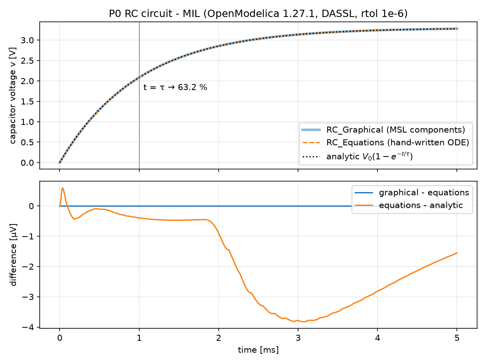

# P0: Toolchain warm-up (Blinky)

> Status: 🚧 ready for review (all "done when" items met; PR #3 merge and `p0-done` tag pending) · Time spent: ~__ h

## 1. Goal
Get every tool producing output **independently** before connecting anything. CubeMX generates a CMake project for the NUCLEO-H743ZI2 that blinks LD1 (PB0) and prints `Hello <n>` on USART3 (ST-LINK VCP, 115200 baud). The **same ELF** (built in the devcontainer) boots in Renode, where a Robot suite checks it, and runs on the real board. Separately, OpenModelica simulates an RC circuit twice, from library components and as a hand-written ODE, and compares both with the analytic answer. There's no closed loop yet; the point is to know what each tool does on its own, and where the Renode H743 platform model stops matching the silicon.

## 2. Platform
| Item | Value |
|---|---|
| SYSCLK / timer clock | 400 MHz / 200 MHz (HCLK 200, APB1–4 100; see [`fw/p0_blinky/CUBEMX.md`](../../fw/p0_blinky/CUBEMX.md)) |
| Clock source / power | HSE bypass 8 MHz (ST-LINK MCO) → PLL1 M=1 N=100 P=2 (VCO 800 MHz, wide); LDO supply, VOS1; flash 2 WS; rev V |
| CubeMX / HAL | STM32CubeMX 6.18, STM32Cube FW_H7 V1.13.0, CMake + GCC |
| Toolchain / image | devcontainer `linux/amd64`: Arm GNU 15.3.rel2 (build arm-15.180), OpenModelica 1.27.1 + MSL 4.0.0, Renode 1.17.0, Robot 6.1, Python 3.11 ([pins](../../docs/dev-environment.md)) |
| Firmware (Debug, canonical) | text 23 848 B, data 96 B, bss 2 056 B (flash 1.14 %, DTCM 1.64 %); `.bin` sha256 `50ac07ca…` |
| Control Ts | N/A in P0 (no control loop) |
| Console | USART3 (PD8/PD9) → ST-LINK VCP / Renode `sysbus.usart3` |
| Plant link | N/A in P0 (starts in P1) |
| Renode | 1.17.0, `@platforms/cpus/stm32h743.repl` + [`renode/p0_overlay.repl`](renode/p0_overlay.repl) (DBGMCU identity = rev V) |
| Plant FMU | N/A in P0 (the RC model is simulated with `simulate()` only) |
| RC model | R = 1 kΩ, C = 1 µF, τ = 1 ms, 3.3 V step, StopTime 5 ms (5τ), DASSL, rtol 1e-6, 500 intervals |

## 3. Features used
🎓 = a first use the roadmap reserves for me. Who actually did each one is in §8.

| Tool | Feature | Where |
|---|---|---|
| STM32 | 🎓 CubeMX board selector (NUCLEO-H743ZI2), clock tree (HSE bypass → PLL1 → 400 MHz), CMake generation | [p0_blinky.ioc](../../fw/p0_blinky/p0_blinky.ioc), [CUBEMX.md](../../fw/p0_blinky/CUBEMX.md) |
| STM32 | USER CODE blocks: `app_init()` / `app_loop()` wired from `main.c`, survived a regeneration | [main.c#L25-L27](../../fw/p0_blinky/Core/Src/main.c#L25-L27), [#L95-L97](../../fw/p0_blinky/Core/Src/main.c#L95-L97), [#L104-L105](../../fw/p0_blinky/Core/Src/main.c#L104-L105) |
| STM32 | Root `CMakeLists.txt` user sections; cross-build via `make fw` (container) | [CMakeLists.txt#L46-L55](../../fw/p0_blinky/CMakeLists.txt#L46-L55), [Makefile#L41](../../Makefile#L41) |
| STM32 | Flash with `st-flash`, SWD reset, timestamped VCP capture, sha256 of the flashed `.bin` | [Makefile#L52](../../Makefile#L52) (`make hw`), [capture_uart.pl](scripts/capture_uart.pl) |
| Dev env | Pinned amd64 devcontainer, `make doctor` | [Dockerfile](../../.devcontainer/Dockerfile), [doctor.sh](../../tools/doctor.sh) |
| Renode | 🎓 `.resc`: `mach create`, `LoadPlatformDescription` (+ overlay), `sysbus LoadELF` | [p0.resc#L10-L23](renode/p0.resc#L10-L23) |
| Renode | 🎓 `showAnalyzer` on USART3 (GUI variant); `LoggingUartAnalyzer` (headless, virtual-time stamps) | [p0_gui.resc#L7](renode/p0_gui.resc#L7), [overlay run logs](results/2026-10-10_renode_overlay/) |
| Renode | 🎓 Reading and annotating the H743 `.repl` (memory map, NVIC, models vs. stubs vs. tags, missing peripherals, fixed clocks) | [stm32h743_annotated.repl](renode/stm32h743_annotated.repl) |
| Renode | 🎓 Overlay `.repl` with a Python peripheral fixing an unmodeled register (DBGMCU_IDC) | [p0_overlay.repl#L19](renode/p0_overlay.repl#L19) |
| Renode | Interactive monitor (`renode --console`): `cpu PC`, `sysbus FindSymbolAt`, `LogPeripheralAccess`, `sysbus Read/WriteDoubleWord` to start and read TIM2/DWT | [renode_clock_check.sh](scripts/renode_clock_check.sh) |
| Renode | `path add` (search path for repo-relative `@paths`); `sysbus ReadDoubleWord` from a test | [renode.resource#L22](../../tests/common/renode.resource#L22), [p0_blinky.robot#L37](robot/p0_blinky.robot#L37) |
| OpenModelica | 🎓 RC circuit from MSL components with `connect()` + diagram annotations | [RC_Graphical.mo#L19](model/RC_Graphical.mo#L19) |
| OpenModelica | 🎓 RC circuit as a hand-written ODE with units and an explicit initial condition | [RC_Equations.mo#L14](model/RC_Equations.mo#L14) |
| OpenModelica | `.mos` scripting: `loadModel`, `loadFile`, `cd`, `simulate` (solver/tolerance explicit, CSV), `checkModel` | [p0.mos#L13-L27](scripts/p0.mos#L13-L27) |
| Robot | 🎓 `Create Terminal Tester`, `Wait For Line On Uart` (virtual-time timeouts), result `Timestamp` | [renode.resource#L24-L30](../../tests/common/renode.resource#L24-L30), [p0_blinky.robot#L22](robot/p0_blinky.robot#L22) |
| Robot | 🎓 My first test: `LD1 Toggles Between Hello Lines` (register read via `Execute Command`, XOR check) | [p0_blinky.robot](robot/p0_blinky.robot) (REQ-P0-05) |
| Robot | Shared resource file, `smoke` tag, requirement-style test names, `renode-test` | [renode.resource](../../tests/common/renode.resource), [p0_blinky.robot](robot/p0_blinky.robot) |
| Robot | Reading `log.html` / `report.html` | [archived run](results/2026-10-10_renode_robot/) |
| CI | GitHub Actions: same Dockerfile (buildx + GHA cache), only `make` targets, evidence artifact | [ci.yml](../../.github/workflows/ci.yml) |
| Control | (none in P0) | |

## 4. How to run
```sh
make doctor                            # devcontainer: every tool version, MSL 4.0.0 loads
make lint                              # devcontainer: ruff + clang-format (our C only)
make fw   P=p0                         # devcontainer only -> build/fw/p0_blinky/ (canonical ELF)
make sim  P=p0                         # devcontainer: RC models -> build/sim/p0/rc_compare.png
make test P=p0 [TAGS=smoke]            # devcontainer: Robot on Renode -> build/robot/p0/log.html
make hw   P=p0 HW_DESC=<desc>          # macOS host, board attached: flash + 20 s capture + meta.json
```
**CI:** [run 38097537787](https://github.com/kiranj26/STM32H7-Nucleo-With-Renode-and-Openmodelica/actions/runs/38097537787) green on 2026-10-11 (image build 3 min 52 s cold; doctor/lint/fw/sim 14 s; smoke suite 9 s); artifact `p0-evidence`.

From a Mac terminal without VS Code: `docker run --rm --platform linux/amd64 -v "$PWD":/work -w /work h7lab:dev make <target> P=p0`.

## 5. Results
Every number links to a dated run folder. Levels: **HW** = the physical board, **Renode** = emulation (virtual time), **MIL** = OpenModelica.

| Metric | Requirement | Renode | HW |
|---|---|---|---|
| Boot banner + `Hello <n>` on USART3 | banner ≤ 1 s virtual (REQ-P0-01/02) | ✅ banner at 25.23 µs virtual ([run](results/2026-10-10_renode_robot/)) | ✅ Mac ELF ([run](results/2026-10-10_hw_hello/)) and canonical ELF `50ac07ca…` ([run](results/2026-10-10_hw_container_elf/)), LD1 blinking |
| Emulated chip identity | DBGMCU_IDC = 0x20030450, rev V (REQ-P0-03) | ✅ ([run](results/2026-10-10_renode_robot/), [before/after logs](results/2026-10-10_renode_overlay/)) | rev V per CubeMX |
| LD1 (PB0) toggles between `Hello` lines | GPIOB ODR bit 0 differs (REQ-P0-05) | ✅ `0x0` → `0x1` ([run](results/2026-10-11_renode_robot/), 5/5 tests) | ✅ LD1 seen blinking |
| `Hello` period | 501 ± 1 ms virtual (REQ-P0-04) | ✅ 500.999 ms ([run](results/2026-10-10_renode_robot/)) | ⚠️ 495.1 / 495.3 ms (two ELFs, n = 39 each): −1.31 % vs. 501.9 ms expected incl. UART TX ([analysis](results/2026-10-10_timing_comparison/)) |
| RC: graphical vs. equations, max \|Δv\| | ≈ 0 | **MIL:** 0.0 V exactly ([run](results/2026-10-10_mil_rc/)) | N/A |
| RC: equations vs. analytic, max \|Δv\| | ≤ rtol × 3.3 V ≈ 3.3 µV order | **MIL:** 3.8 µV; v(τ) = 2.085997 V vs. 2.085998 V expected ([run](results/2026-10-10_mil_rc/)) | N/A |




**Reading the timing plot:** Renode gives exactly the period the firmware asks for (`HAL_Delay(500)` = 501 ticks; UART bytes are instant in Renode). The board is about 1.3 % short with both binaries, so the offset belongs to the board's clock, not the code (§6).

## 6. Problems hit
- **CubeMX showed no error with DIVN1 = ×129**: 8 MHz × 129 = 1032 MHz VCO is out of range, but the System Clock Mux was still on HSI, so PLL1 wasn't used and its outputs were greyed out instead of red → set DIVN1 = 100 *before* switching the mux to PLLCLK ([CUBEMX.md §3](../../fw/p0_blinky/CUBEMX.md)). *Lesson:* CubeMX only validates clock paths that are actually in use; check the VCO by hand.
- **`app_loop()` would have been deleted on the next regeneration**: I pasted it between `USER CODE END WHILE` and `USER CODE BEGIN 3`, which is outside every block → moved it inside block 3 ([main.c#L104-L105](../../fw/p0_blinky/Core/Src/main.c#L104-L105)); it then survived a regeneration. *Lesson:* only text strictly between a BEGIN/END pair is mine; the gap between two blocks still belongs to CubeMX.
- **`screen -L -Logfile …` → "Unknown option Logfile"**: macOS ships `screen` 4.00.03 (2006); `-Logfile` came in 4.06 → captured with `stty` + a Perl reader instead ([capture_uart.pl](scripts/capture_uart.pl)). *Lesson:* check the tool version (`screen -v`) before trusting docs for the current release.
- **`zsh: resource busy: /dev/tty.usbmodem31403`**: two detached `screen` sessions from earlier still held the port (`lsof /dev/tty.usbmodem*` showed them) → `screen -S <pid> -X quit`. *Lesson:* a serial port has one owner; closing a terminal window detaches `screen`, it doesn't kill it (`Ctrl-A K` kills).
- **First capture started with `Hello 9`…`Hello 39`, all with the same timestamp, before the boot banner**: bytes sent before the reset were still buffered in the USB VCP path → the script drains the port for 0.7 s before resetting ([capture_uart.pl](scripts/capture_uart.pl)). *Lesson:* identical timestamps on many lines mean "buffered", not "sent together".
- **`uart.log` didn't show in `git status`**: a global `*.log` rule in `.gitignore` hid my evidence → added `!projects/*/results/**/*.log`. *Lesson:* run `git check-ignore -v <file>` when a file you expect is missing from `git status`.
- **Mac-built and container-built `.bin` differ (2 161 bytes) despite identical size**: Arm's prebuilt `libc_nano.a` has a different member order on macOS than on Linux (e.g. `nano-svfprintf.o` is member 126 on the Mac vs 248 on Linux), so the linker places `printf`/`malloc` at different addresses. The first differing instruction is `bl _svfiprintf_r` in `snprintf` (→ 0x08005488 on the Mac vs 0x08005674 in the container); the function set and sizes are identical. Pinning the same compiler build (15.3.rel2 = arm-15.180) didn't change it → the container-built ELF is canonical, the Mac only flashes ([dev-environment.md](../../docs/dev-environment.md)); both binaries time the same on the board (495.1 vs 495.3 ms). *Lesson:* "same compiler version" doesn't mean "same binary"; compare `.bin` hashes, then `nm` and `objdump` to find *what* differs before deciding whether it matters.
- **CMake Tools wrote a container-only path into the shared `.vscode/settings.json`** (`"cmake.sourceDirectory": "/work/fw/p0_blinky"`) after a "Select CMakeLists.txt" prompt in the devcontainer window → reverted; dismiss that prompt. *Lesson:* only `make` drives the build; IDE prompts can leak one side's paths into files both sides share.
- **The predicted Renode boot hang (RCC/PWR ready flags) did not happen**: Renode 1.17.0's `stm32h7.repl` already stubs PWR as a Python peripheral that always reports ACTVOSRDY/VOSRDY, and models RCC → boot reaches `P0 blinky boot` at 25 µs virtual ([logs](results/2026-10-10_renode_overlay/)). *Lesson:* check the current upstream platform before planning a fix; troubleshooting T1 was a prediction, not a finding.
- **Renode took the silicon rev-Y errata path the real board skips**: `ReadDoubleWord from non existing peripheral at 0x5C001000`, then a write into the GPV AXI-matrix tag. DBGMCU isn't modeled, IDCODE reads 0, and `SystemInit` ([system_stm32h7xx.c:262](../../fw/p0_blinky/Core/Src/system_stm32h7xx.c#L262)) treats REV_ID < 0x2000 as rev Y → [p0_overlay.repl](renode/p0_overlay.repl) reports IDCODE 0x20030450 (rev V); both warnings disappear and a Robot test guards it ([before/after](results/2026-10-10_renode_overlay/)). *Lesson:* a warning that doesn't hang anything can still mean the emulator runs a different code path than the silicon; fix the platform, not the firmware.
- **My SysTick prediction for Renode was wrong**: the platform says `systickFrequency: 480_000_000`, so I expected 400 000 / 480 MHz × 501 ≈ 417 ms virtual. Measured 500.999 ms: the `STM32H7_RCC` model (`systick: nvic`) re-times SysTick from the firmware's PLL writes ([annotated repl](renode/stm32h743_annotated.repl)). *Lesson:* the `.repl` value is a start value, not the truth; measure.
- **`renode-test` ignored `-r`/`-o` and wrote `log.html`, `logs/`, `snapshots/` into the repo root; relative `@paths` failed** ("File does not exist: projects/…") because the Renode server doesn't run in the repo root → `make test` runs `renode-test` from `build/robot/p0/`, and `Boot Project` does `path add @<repo>` first ([renode.resource#L22](../../tests/common/renode.resource#L22)). *Lesson:* test a tool's output-location flags with a throwaway probe before wiring them into a Makefile.
- **The PR first claimed Renode's timers stay at 250 MHz; my own M7 lab measured 200 MHz** (TIM2 counted 200 000 in 1 ms virtual after boot). Claude's original check had run on an empty machine (no firmware, so RCC never configured → the `.repl`'s 250 MHz start value). Re-measured all four cases: timers ARE re-timed by the RCC model (200 MHz = CubeMX, fine for P1); **DWT is not** (stays 250 MHz vs. 400 MHz CPU, so P3 cycle counts would be 1.6× off) ([script](scripts/renode_clock_check.sh), [run](results/2026-10-11_renode_clock_check/)). *Lesson:* measure an emulator in the real configuration; re-run a check before trusting it when its conditions differ from the claim.
- **Board `Hello` period is 495.1 ms, not ~501.9 ms (HW)**: expected 501 ticks (`HAL_Delay` adds one tick) + ~0.9 ms TX. Short means the CPU runs *faster* than HAL assumes, which points at an HSE input of ≈ 8.1 MHz from the ST-LINK MCO instead of exactly 8 MHz. Reproduced with the canonical ELF (495.3 ms); Renode gives 500.999 ms with the same binary, so it follows the board's clock, not the code ([analysis](results/2026-10-10_timing_comparison/)). Cause _open_, not yet tested (MCO1 on PA8 with a scope, or an HSI A/B test). *Lesson:* the MCU can't detect its own clock error; only an external reference shows it. I first guessed "lower than 8 MHz", which has the direction backwards.

## 7. What I'd do differently
<!-- Written by me, not generated. -->

## 8. 🎓 Steps (who did what)
Done by hand by me:
- [x] Create `p0_blinky.ioc` in CubeMX and generate CMake ([CUBEMX.md](../../fw/p0_blinky/CUBEMX.md)), 2026-10-10
- [x] Wire `app/` into `main.c` USER CODE blocks and `CMakeLists.txt` (Claude supplied the snippets)
- [x] Flash the board and see `Hello` + LD1 (first run); install the host toolchain; test the devcontainer in VS Code (11 checks)
- [x] Learning labs (2026-10-11): two `make hw` runs (day-to-day clock drift, not archived), Renode monitor session that **disproved the "timers stuck at 250 MHz" claim** (corrected in `bf26ce2`), and REQ-P0-05 `LD1 Toggles Between Hello Lines` added and run 5/5 ([run](results/2026-10-11_renode_robot/); test text supplied by Claude, chosen, run and verified by me)

Done by Claude on autopilot at my request (2026-10-10); **not yet done by hand**. Worth redoing as exercises:
- [ ] First `.resc` boot in Renode ([p0.resc](renode/p0.resc))
- [ ] Hunt the boot problem with `LogPeripheralAccess` + `cpu PC` and fix it in an overlay (here: no hang; DBGMCU rev-Y path fixed instead, [p0_overlay.repl](renode/p0_overlay.repl)). Exercise: delete the overlay line, rerun, and find the two warnings yourself.
- [ ] Annotate `stm32h743.repl` ([stm32h743_annotated.repl](renode/stm32h743_annotated.repl)). Exercise: verify section 4 (fixed clocks) with one TIM register read.
- [ ] RC models and the choice of R, C, StopTime from τ ([model/](model/)). Not drawn in OMEdit: there's no display in the container. Exercise: open `RC_Graphical.mo` in OMEdit on any machine with a display.
- [ ] First Robot test waiting for `Hello` ([p0_blinky.robot](robot/p0_blinky.robot))
- [x] Flash the same ELF to the board and confirm the same output: canonical ELF `50ac07ca…` on HW ([run](results/2026-10-10_hw_container_elf/), `make hw` run by Claude on my board) and in Renode ([run](results/2026-10-10_renode_robot/))
